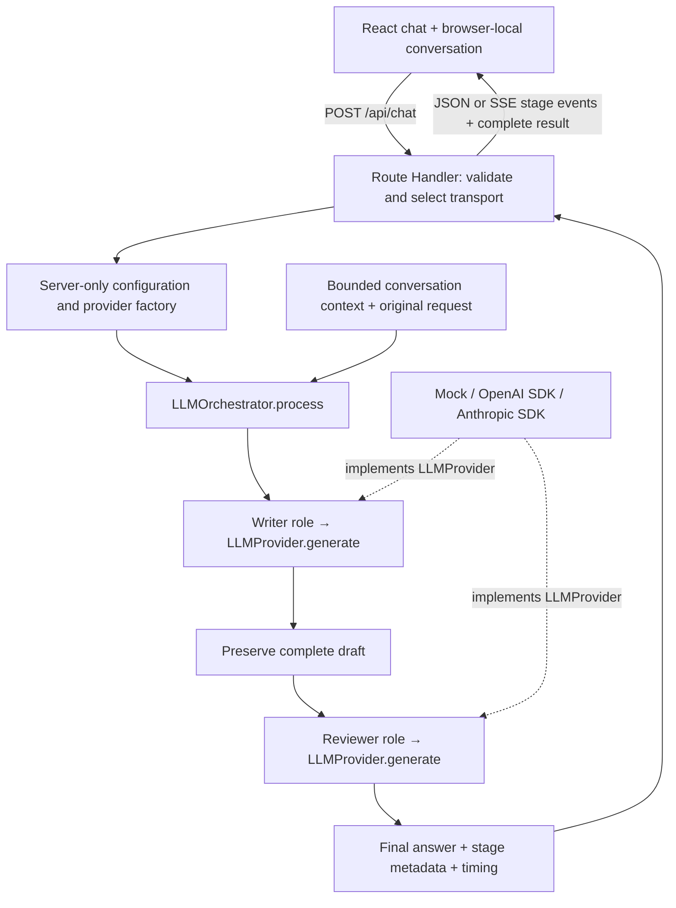

# Duet · Writer → Reviewer chat

A working Next.js App Router chat application with exactly two sequential model roles. The Writer produces a complete draft; the Reviewer receives the original request, recent conversation context, and the **complete actual draft**, then produces the final answer. The UI displays the final answer and lets you inspect both stages.

**Runs locally without credentials, paid services, authentication, or a database.** Mock mode is the default. Mock responses are deterministic templates clearly labeled as simulated; they demonstrate the workflow and do not answer arbitrary questions intelligently.

## Quick start

Requires Node.js **20.19+** (Node 22 LTS also supported) and npm.

```bash
npm ci
cp .env.example .env.local
npm run dev
```

Open [http://localhost:3000](http://localhost:3000). Copying the environment file is optional in mock mode. Send a message, watch the Writer and Reviewer statuses, and open **Behind the response** to compare outputs. Send a follow-up to exercise conversation context. **New conversation** clears the active browser-local conversation.

```bash
npm run lint
npm run typecheck
npm test
npm run build
npm start
```

`npm run test:watch` runs Vitest interactively. Development and production scripts use Next.js’s supported webpack builder for compatibility with restricted environments. The lockfile pins dependency versions. The official OpenAI SDK is pinned to a Node 20-compatible release.

## Architecture



There is no planner, analysis stage, or third LLM call. Both roles depend on `LLMProvider`, not vendor SDKs. Providers can be swapped or shared between stages. SDK retries are disabled, so the application makes one attempt per stage. A successful Writer is followed by exactly one Reviewer invocation unless the caller has cancelled the request. Cancellation stops pending work.

| Location                       | Responsibility                                                                            |
| ------------------------------ | ----------------------------------------------------------------------------------------- |
| `src/domain/chat.ts`           | Provider interface, typed transport contracts, Zod validation, input/output bounds        |
| `src/config/llm.ts`            | Server-only environment validation; mock mode bypasses credentials                        |
| `src/providers/`               | Deterministic mock provider, official SDK adapters, factory                               |
| `src/services/roles.ts`        | Separate Writer and Reviewer prompts and request construction                             |
| `src/services/orchestrator.ts` | Sequential execution, per-stage timeout, safe failures, fallback, timing                  |
| `src/app/api/chat/route.ts`    | Thin API boundary; bounded input, config, JSON/SSE transport                              |
| `src/lib/chat-client.ts`       | Typed SSE consumer, network/transport failure handling                                    |
| `src/lib/conversations.ts`     | Versioned browser storage schema and bounded recent context selection                     |
| `src/components/`              | Accessible composer, status, conversation, comparison panel                               |
| `tests/`                       | Mock, orchestration, config, official adapter contracts, API, context and transport tests |

The Reviewer receives the draft in a JSON data envelope, with system instructions explicitly treating it as untrusted material. It must critically assess the answer, preserve intent, avoid unsupported additions, and never claim tool-based verification. This is a prompt boundary, not a guarantee against prompt injection or factual mistakes. No external verification tools are configured.

## Enable real providers later

Edit the server's **`.env.local`** and restart Next.js:

```dotenv
LLM_MODE=live
WRITER_PROVIDER=openai
WRITER_MODEL=your-enabled-openai-model-id
REVIEWER_PROVIDER=anthropic
REVIEWER_MODEL=your-enabled-anthropic-model-id
OPENAI_API_KEY=your-openai-key
ANTHROPIC_API_KEY=your-anthropic-key
```

Replace placeholders with model IDs available to your accounts. Both model IDs are deliberately unset by default. Missing or unsupported provider settings, missing models/keys, and invalid numeric limits produce a sanitized configuration error. The page remains usable enough to show the error; a chat request returns HTTP 503 before contacting a provider. You may swap the providers or use either provider for both roles.

The adapters use the official [OpenAI Responses API](https://developers.openai.com/api/reference/typescript/resources/responses/methods/create) and [Anthropic TypeScript SDK](https://platform.claude.com/docs/en/cli-sdks-libraries/sdks/typescript). OpenAI requests set `store: false`. All SDK clients and credentials remain server-side; only provider/model identifiers are sent to the UI. Never use `NEXT_PUBLIC_` for credentials. `.env*` is ignored except `.env.example`.

Live integrations have contract tests with mocked SDKs. Actual account access, model support, billing, latency, and live answer quality require a later credentialed smoke test. No paid API calls are needed for the test suite.

## Environment variables

| Variable                | Default         | Purpose                                                             |
| ----------------------- | --------------- | ------------------------------------------------------------------- |
| `LLM_MODE`              | `mock`          | `mock` or `live`                                                    |
| `WRITER_PROVIDER`       | ignored in mock | `openai` or `anthropic` in live mode                                |
| `WRITER_MODEL`          | ignored in mock | Required live model identifier                                      |
| `REVIEWER_PROVIDER`     | ignored in mock | `openai` or `anthropic` in live mode                                |
| `REVIEWER_MODEL`        | ignored in mock | Required live model identifier                                      |
| `OPENAI_API_KEY`        | none            | Required when a live stage uses OpenAI                              |
| `ANTHROPIC_API_KEY`     | none            | Required when a live stage uses Anthropic                           |
| `LLM_TIMEOUT_MS`        | `30000`         | Per-stage deadline, integer 1,000–60,000 ms                         |
| `LLM_MAX_OUTPUT_TOKENS` | `2048`          | Per-stage generated token limit, integer 256–4,096                  |
| `MOCK_DELAY_MS`         | `700`           | Simulated delay per stage, integer 0–2,000 ms; set 0 for fast tests |

Mock mode ignores live provider choices, models, and credentials and never constructs an SDK client or contacts a model API. Changing the simulated delay does not change mock output text.

## API contract

`POST /api/chat` accepts `Content-Type: application/json`:

```json
{
  "message": "Explain a queue",
  "history": [
    { "role": "user", "content": "I am learning programming." },
    { "role": "assistant", "content": "Let's start with simple examples." }
  ]
}
```

`history` is optional. It contains previous messages only; the server appends the current request. Browser history includes the final answer or an explicitly warned fallback draft, never an internal draft when review succeeded. Only user and assistant roles are accepted; clients cannot supply system prompts or configure providers.

The response includes:

```json
{
  "id": "request-uuid",
  "mode": "mock",
  "originalMessage": "Explain a queue",
  "finalAnswer": "[SIMULATED REVIEWED RESPONSE] ...",
  "writerDraft": "[SIMULATED WRITER DRAFT] ...",
  "reviewerOutput": "[SIMULATED REVIEWED RESPONSE] ...",
  "status": "completed",
  "stages": {
    "writer": {
      "provider": { "id": "mock", "model": "simulated-writer-v1" },
      "status": "completed",
      "latencyMs": 700
    },
    "reviewer": {
      "provider": { "id": "mock", "model": "simulated-reviewer-v1" },
      "status": "completed",
      "latencyMs": 700
    }
  },
  "totalMs": 1400
}
```

Times above are illustrative, measured with a monotonic clock, and include adapter execution. An optional `error` contains a safe `code`, `message`, and `stage`.

- HTTP 200: `completed`, or `review_failed` with `finalAnswer` equal to the preserved Writer draft and an explicit warning.
- HTTP 400: malformed JSON, invalid input, excessive input size, or body-read deadline.
- HTTP 403 / 415: cross-origin browser request / unsupported request content type.
- HTTP 503: invalid server configuration.
- HTTP 502 / 504: Writer failure / Writer timeout. The Reviewer is skipped.

Validation/configuration errors use `{ "error": { "code": "...", "message": "..." } }` before generation starts. Provider failures never forward raw exceptions, keys, or stack traces.

For the UI, `Accept: text/event-stream` selects SSE. The server emits two real progress events and one complete result:

```text
data: {"type":"stage","stage":"writer"}

data: {"type":"stage","stage":"reviewer"}

data: {"type":"result","result":{...}}
```

This streams **stage progress**, not generated answer tokens. The server awaits the entire draft before reviewing. Once SSE headers are sent, generation failures are encoded in the result instead of changing HTTP status. A request cancelled before completion may not deliver a final result. The browser treats premature connection closure as an error. Stop and client disconnect propagate cancellation to the SDKs. The browser has a 130-second deadline, above the maximum combined stage budget.

A CLI smoke test:

```bash
curl -s http://localhost:3000/api/chat \
  -H 'Content-Type: application/json' \
  -d '{"message":"Explain a queue"}'
```

Add `-N -H 'Accept: text/event-stream'` to inspect progress events.

## State and limits

- One active conversation in `localStorage`, versioned and validated at load, with the most recent 30 turns retained. New conversation replaces it. Nothing is saved on a server.
- Local storage contains messages, drafts, final responses, and diagnostics. Use a private browser profile for private material. Storage failure is visible and does not prevent chatting.
- At most 4,000 characters per current message, 20 history messages, and 24,000 combined history characters. The UI sends complete recent pairs within that budget; oversized API input is rejected.
- Request bodies are bounded to 160,000 bytes while reading, including chunked requests. Body reads have a 10-second deadline.
- Every stage has a token cap and a 24,000-character output cap. Empty, oversized, or provider-marked incomplete outputs are treated as failures. Complete valid drafts are never silently truncated before review.
- Provider errors, network errors, and timeouts are visible. Reviewer failure displays **Unreviewed draft** with a warning, never a Reviewed badge. A failed Writer does not add an assistant answer to future context.

## Validation record

See [docs/validation.md](docs/validation.md) for automated test results, browser checks, accessibility checks, and the live-API verification boundary.

## Current limitations and next steps

This is a local MVP, with no authentication, per-user rate limiting, database, cross-device history, attachments, external fact-checking, or Markdown rendering. Answers are safely rendered as plain text. Do not expose live mode as a public paid API without authentication and abuse controls. Character limits are a simple token-budget proxy, not exact token accounting. Model capability compatibility still needs testing with your selected model IDs. Browser cancellation stops delivery and attempts to abort requests; a provider may already have incurred usage.

The existing boundaries support the following later additions without rewriting the UI around vendors:

- Add adapters behind `LLMProvider` and extend the server factory.
- Add server-validated model selections and an allowlist before exposing model choice in the UI.
- Extend the typed SSE events with token deltas while preserving complete Writer output for review.
- Replace local conversation persistence with a repository backed by PostgreSQL.
- Add usage and cost fields to `GenerationResult` and stage metadata.
- Extend the existing comparison panel into an evaluation workspace.
- Add alternative orchestration services independently of the API transport.

No extra LLM stages are included in this implementation.
